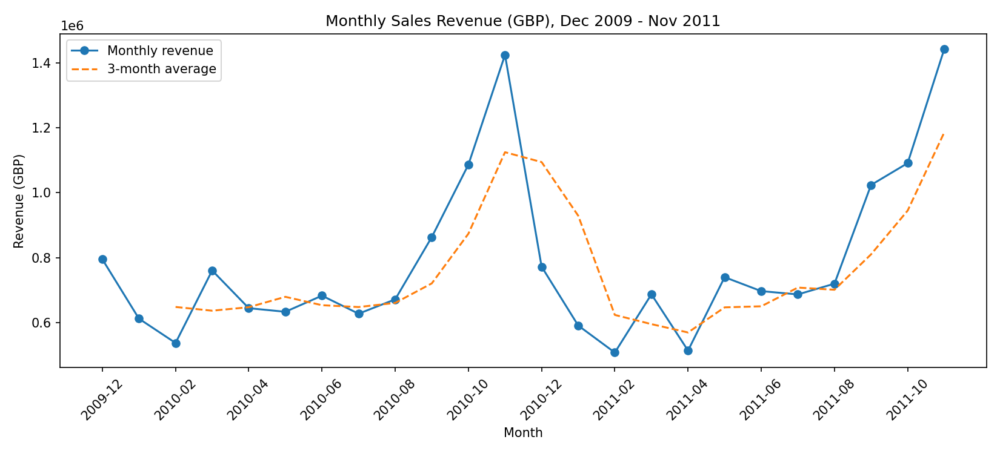
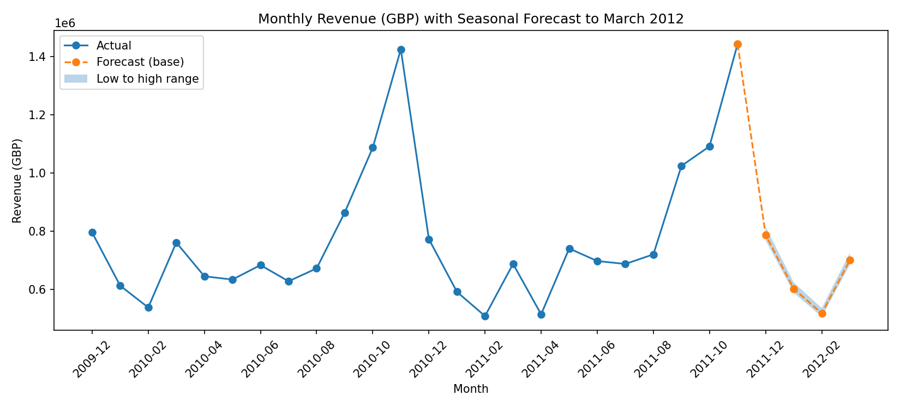
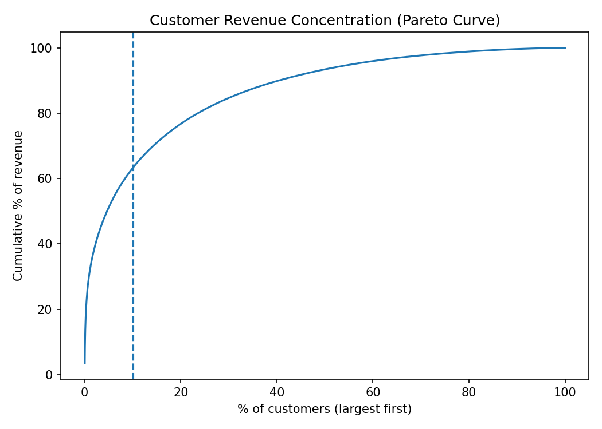
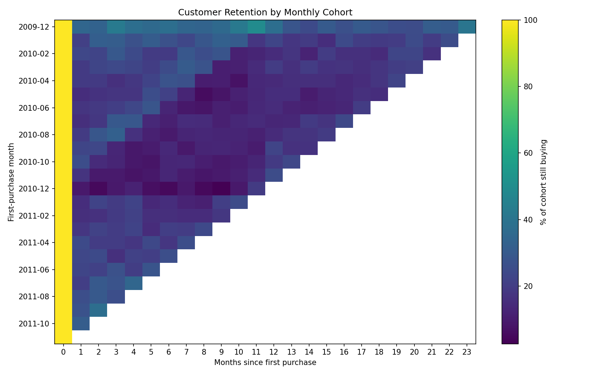
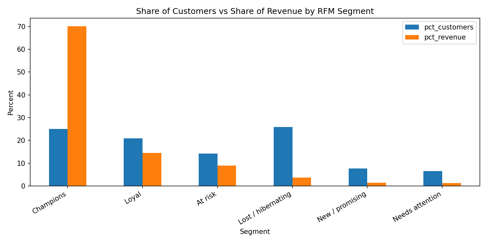
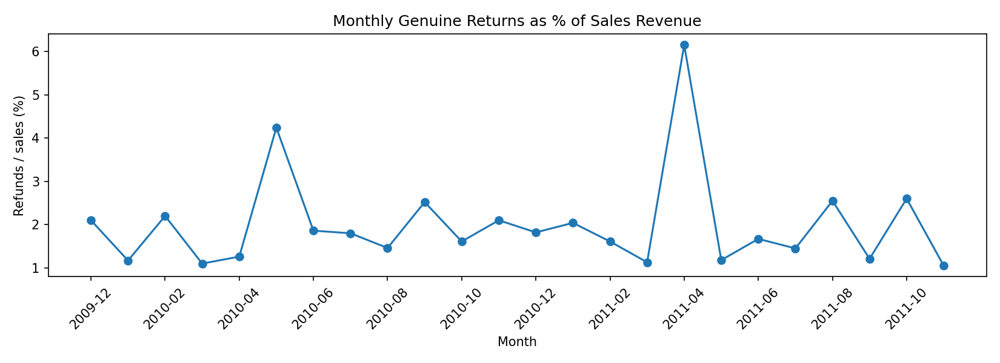

# E-Commerce Business Intelligence: Revenue, Returns and Customer Analysis

Python (pandas) analysis of 1.07 million transactions from a UK online gift-ware wholesaler, December 2009 to December 2011. The project turns messy transaction data into answers a manager can act on: how fast the business is growing, when and where it earns, what returns cost, and which customers matter.

Author: Salim Abdhallah Jumadary | Tools: Python, pandas, NumPy, matplotlib | Dataset: Online Retail II (UCI)

## Headline findings

| Question | Answer |
|---|---|
| Is the business growing? | Barely. Jan-Nov 2011 revenue was 1.8% above 2010 (£8.70M against £8.54M). January to August fell 0.5%; all of the growth came in September to November (+5.4%) |
| When does it earn its money? | In the autumn. October to December months bring 35.1% of revenue, and November peaks near £1.4M |
| How dependent is it on a few customers? | 25% of customers (RFM "Champions") bring 70.1% of identified revenue; the top 10% of customers bring 63.2% |
| What do returns cost? | 1.9% of sales (£365K) once order-entry reversals are removed. The raw figure is about 3.6% |
| What was hiding in the data? | 49.0% of refund value was order-entry reversals made within 24 hours, including an 80,995-unit order (£168K) cancelled 12 minutes later |
| Do customers come back? | 72.3% of identified customers ordered more than once. Roughly one in five of a cohort buys in any later month |

## Charts

Strong autumn peaks and no clear year-on-year growth.

Scenario range for Dec 2011 to Mar 2012 (base case £2.60M). The backtest on Sep-Nov 2011 was 5.6% too low, so treat it as a rough guide.

Revenue depends heavily on a small group of customers.

Retention levels off near one in five; customers return in the autumn.

Champions are 25% of customers and 70.1% of revenue.

Return spikes were mostly single bulk returns, not a general trend.

## Data quality: what I found and did

- **Two worksheets overlapped.** The same 22,523 rows for 1-9 December 2010 appeared in both. I removed one copy; keeping both would have double counted nine days of sales.
- **Almost half of the refunds were mistakes being undone.** I matched each cancellation to the nearest earlier sale by the same customer, for the same product and the exact opposite quantity, within 24 hours. That found 1,331 reversed order lines (£389K of sales). They are excluded from performance tables but kept in the raw files.
- **Many large orders have no customer ID.** About 13% of revenue (£2.6M) is anonymous, including 4 of the 5 largest orders. Customer analysis covers identified customers only.
- **Every row is kept and labelled** (sale, return, duplicate, non-product, adjustment, bad price) instead of being deleted, so every figure can be traced to a rule. Details: documentation/cleaning_decisions.md.

## Method and checks

- The pipeline is a set of numbered scripts in src/. Each one asserts the numbers verified during the analysis, so the pipeline stops if a result changes. The latest run is logged in outputs/pipeline_log.txt.
- Large and odd results were investigated before being reported (for example an apparent top-5 product that was a cancelled data-entry error, and return-rate spikes that came from single invoices).
- The forecast uses last year's same month times a growth rate taken from the data, and was backtested on Sep-Nov 2011.
- All findings, with the question, result and meaning, are in documentation/findings.md.

## Limitations

- Customers without an ID cannot be matched to refunds or tracked over time.
- Returns carry no link to the original sale, so the return rate compares refunds and sales in the same period.
- Two years of data cannot separate trend from seasonality, and the data ends on 9 December 2011.
- The 24-hour reversal window and the RFM segment rules are judgement calls.
- The data cannot explain why customers returned certain products or why September 2011 jumped.

## Repository structure

    src/               numbered scripts that rebuild everything (run_all.py runs them in order; 02_audit.py is a standalone audit)
    documentation/     findings, cleaning decisions, data dictionary, data quality audit, technique index
    reports/           one-page executive summary
    outputs/figures/   charts
    outputs/tables/    result tables
    data/              not included (see below)

## How to reproduce

1. Download online_retail_II.xlsx from the UCI repository (link below) and save it as data/raw/Online_Retail_II.xlsx.
2. Install the packages: pip install -r requirements.txt
3. Run the pipeline: python src/run_all.py

Reading the Excel file takes several minutes. The raw and processed data are not in this repository because of their size.

## Skills demonstrated

Loading and combining Excel data, data cleaning and validation, boolean filtering, groupby and aggregation, pivot tables, time-based joins (merge_asof), datetime features, rolling averages, cohort analysis, RFM segmentation, forecasting with a backtest, plotting with matplotlib, and documenting decisions. See documentation/skills_matrix.md.

## Possible extensions

- A customer lifetime value model and churn prediction on the RFM segments.
- A SQL (PostgreSQL) version of the analysis.
- An interactive dashboard for the monthly KPIs.
- A study of why September 2011 jumped, using product and customer-level detail.

## Data source

Chen, D. (2012). Online Retail II [Dataset]. UCI Machine Learning Repository. https://doi.org/10.24432/C5CG6D (CC BY 4.0). Source page: https://archive.ics.uci.edu/dataset/502/online+retail+ii

## License

The code is released under the MIT License (see LICENSE). The dataset is not included; it belongs to its authors and is available from UCI under CC BY 4.0.
